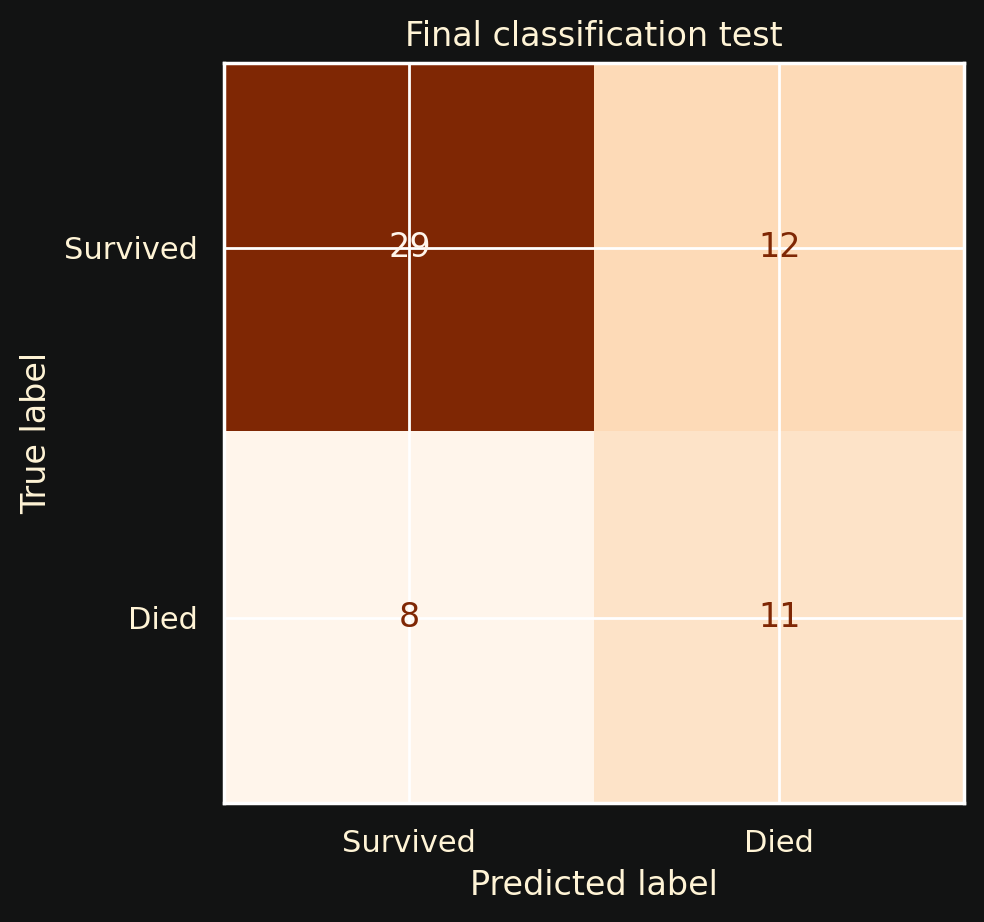
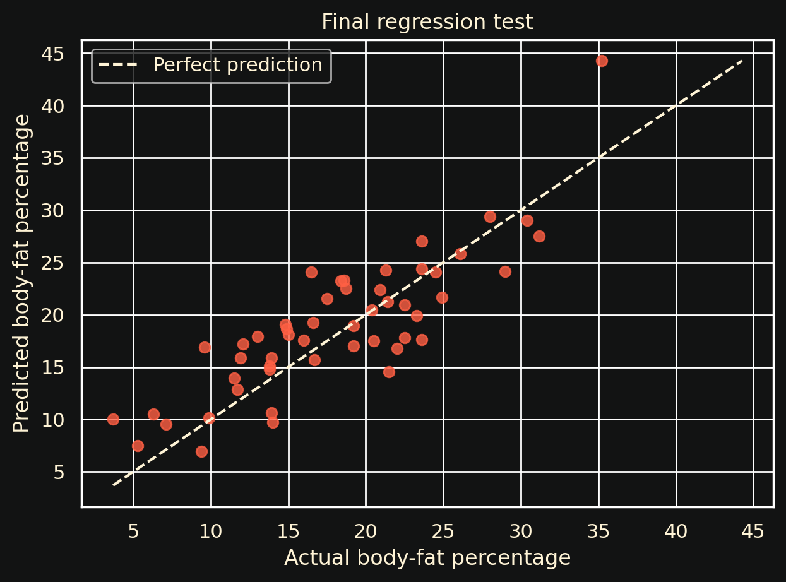
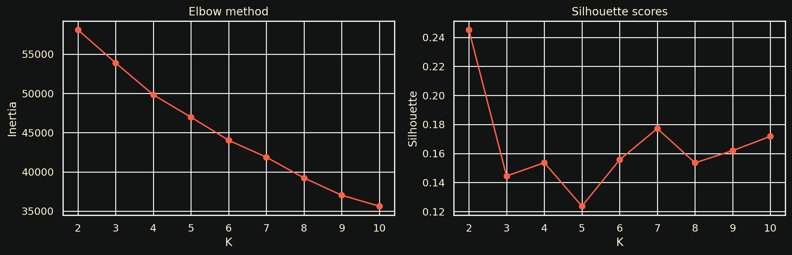

# Health Machine Learning Study

A machine learning study built around three health datasets and three different problem types:

- heart-failure classification
- body-fat regression
- obesity clustering

The project was completed for CS362 Artificial Intelligence. The goal was not only to train models, but to compare approaches, avoid leakage, evaluate them properly, and explain the limits of the results.

## Tasks and results

| Task | Final approach | Final result |
|---|---|---|
| Heart-failure classification | Cost-sensitive Logistic Regression, threshold 0.42 | Recall 0.579 · F1 0.524 · ROC-AUC 0.734 |
| Body-fat regression | Weighted Voting Regressor | MAE 3.184 · RMSE 3.813 · R² 0.688 |
| Obesity clustering | K-Means, K=2 | Silhouette ≈ 0.245 |

## 1. Heart-failure classification

The first task asks whether clinical measurements can help identify patients at higher risk of death after heart failure.

I compared several classifiers, including Logistic Regression, KNN, Decision Tree, Random Forest, and a weighted voting model.

The final model used cost-sensitive Logistic Regression with a lower decision threshold to give more importance to recall.

One important decision was removing the follow-up `time` column. It looks predictive, but it contains information that would only be known later, so using it would introduce data leakage.

### Final test

- Accuracy: 66.7%
- Recall: 57.9%
- F1: 52.4%
- ROC-AUC: 0.734
- Test set: 60 patients



## 2. Body-fat regression

The second task estimates body-fat percentage from body measurements.

I compared Linear Regression, KNN, Decision Tree, Random Forest, Ridge, and a weighted voting regressor.

The `Density` feature was excluded because body-fat percentage is calculated from it, making it too close to the target.

The final model was a Weighted Voting Regressor combining multiple models.

### Final test

- MAE: 3.184 percentage points
- RMSE: 3.813
- R²: 0.688
- Test set: 51 people



## 3. Obesity clustering

The third task explores whether broad obesity patterns can be found without using the existing obesity category as an input.

The existing `NObeyesdad` label was hidden while K-Means created the clusters and was only used afterward to understand the result.

I tested K values from 2 to 10 and used inertia and silhouette score to compare them.

K=2 produced the highest silhouette score in the verified run, at about 0.245.



The clusters were stable across several random seeds, but the silhouette score is modest. The groups overlap and should not be treated as medical categories.

## What I worked with

<p>


</p>

The notebook covers:

- data cleaning and exploratory analysis
- class balance and correlations
- train/test splitting
- five-fold cross-validation
- feature engineering and feature selection
- Grid Search
- threshold tuning
- model comparison
- ensemble models
- regression evaluation
- K-Means clustering and K selection
- clustering stability checks

## Project structure

```text
health-ml-study/
├── notebook/
│   └── health_ml_study.ipynb
├── figures/
├── data/
│   └── README.md
├── requirements.txt
└── README.md
```

The datasets are not redistributed in this repository. Their original sources are linked in `data/README.md`.

## Limitations

This project is an academic study, not a clinical system.

- The heart-failure test set is small.
- The body-fat dataset contains only men.
- The clustering groups overlap and are not medical diagnoses.
- Larger and more diverse datasets would be needed before using these results in a real setting.

## Running the notebook

Install the dependencies:

```bash
pip install -r requirements.txt
```

Download the three datasets listed in `data/README.md` and place them in the `data/` folder.

Then open:

```text
notebook/health_ml_study.ipynb
```
